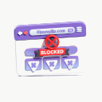
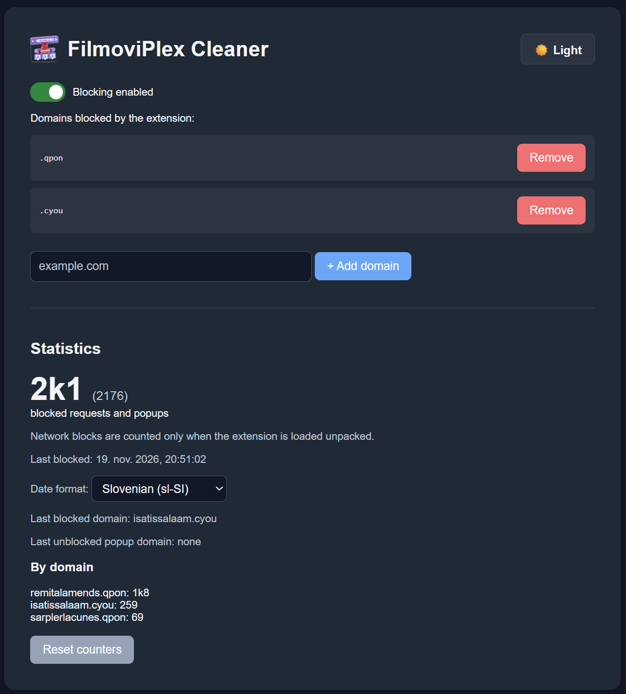
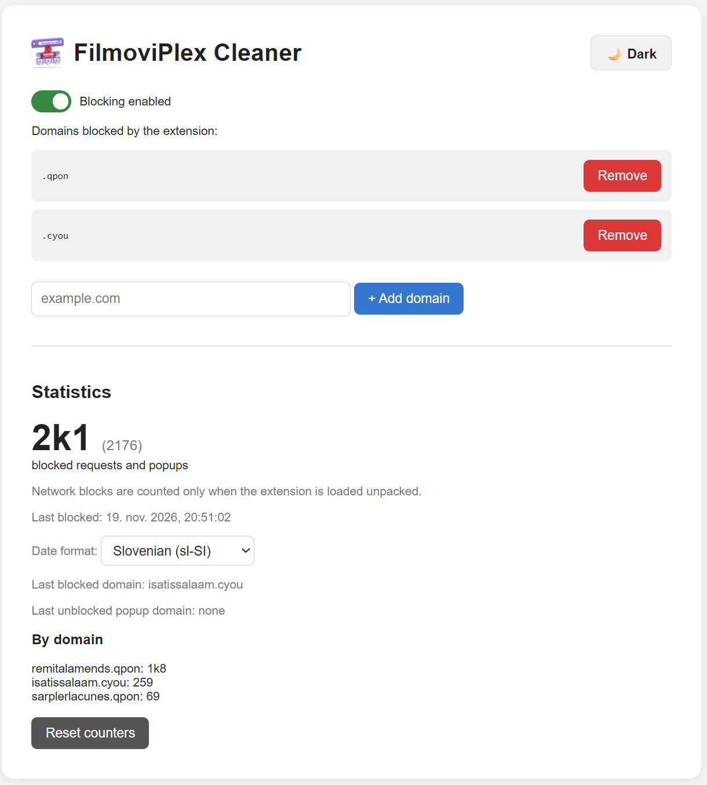
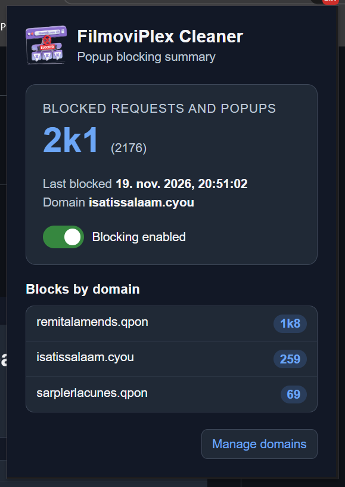

# FilmoviPlex Cleaner

A Chromium-based browser extension that blocks unwanted popup domains associated with FilmoviPlex pages. It is designed to work in Brave, Google Chrome, Microsoft Edge, Opera, Vivaldi, and other Manifest V3-compatible Chromium browsers.

## Icon

## What it does

This extension is specifically designed to block popup domains that often bypass Brave Shields, DuckDuckGo Privacy Protection, and other general popup/ad blockers.

This extension:

- blocks configured domains from loading in the browser
- catches popup traffic that standard browser shields and ad blockers can miss
- tracks page-level blocks and, when loaded unpacked, network-rule blocks
- shows blocking statistics when the extension toolbar icon is clicked
- shows the most recent blocked domain in the popup and options page
- keeps the last blocked domain as plain text and separately lists the last unblocked popup domain
- lets you add the last unblocked popup domain to the blocked-domain list with one click
- lets you add or remove blocked domains and pause or resume blocking
- follows the browser's light or dark theme automatically in the popup
- supports dark and light theme in the options screen

> Important: this extension targets popup domains used by FilmoviPlex pages and can block sources that Brave Shields, DuckDuckGo shields, and other generic popup/ad blockers do not reliably stop.

## Files

- `background.js` — background service worker that stores settings and applies dynamic network rules
- `blocker.js` — main-world script that watches page traffic and reports blocked content
- `bridge.js` — isolated-world bridge that relays messages from the page to the extension
- `format.js` — shared compact number formatter (e.g. `1k2`) used by the badge, popup, and options page
- `popup.html` — toolbar popup that displays the extension icon and blocking statistics
- `popup.js` — popup statistics and options-page launcher logic
- `options.html` — extension settings page
- `options.js` — settings page logic, counts, theme toggle, and last-blocked-domain handling
- `manifest.json` — extension manifest and permissions
- `icons/` — icon assets

## Installation

1. Open your Chromium-based browser (for example Brave, Chrome, Edge, Opera, or Vivaldi).
2. Go to the extensions page for that browser.
3. Enable Developer mode.
4. Click Load unpacked.
5. Select this project folder.

This extension is intended for Chromium-based browsers that support Manifest V3 extensions.

## Usage

1. Click the FilmoviPlex Cleaner icon in the browser toolbar to view blocked-popup statistics.
2. Use **Manage domains** in the popup to open the extension options page.
3. Add or remove domains in the extension options page. Full HTTP(S) URLs are accepted and normalized to their domain; subdomains are included. You can also add top-level domains or suffixes such as `.qpon`, `qpon`, `.cyou`, or `cyou`, which block all subdomains under that suffix.
4. Visit FilmoviPlex pages and the extension will automatically block matching popup traffic.

Use **Blocking enabled** in the popup or options page to pause or resume blocking. Domain and pause changes are sent to open FilmoviPlex frames automatically. Resetting statistics requires confirmation.

In the options page, the last blocked domain is displayed as plain text. When a popup opens on a domain that is not in the blocked-domain list, the **Last unblocked popup domain** line shows that domain and lets you add it with a click.

The toolbar popup follows the browser's light or dark appearance automatically. It does not have a theme button.

## Default domains

The extension starts with these top-level domains blocked by default:

- `.qpon`
- `.cyou`

## Screenshots

### Options page

#### Dark

#### Light

### Extension icon in browser

### Statistics popup

## Notes

- The extension uses Chrome extension APIs such as `chrome.storage` and `chrome.declarativeNetRequest`.
- The toolbar badge, popup, and options page all show compact counts like `1k`, `1k1`, and `1M` for large numbers.
- Network rules apply to configured destination domains across browser navigations, including links opened from third-party frames and history navigations.
- Counts include blocked network requests as well as popups. Chrome only reports individual network-rule matches to unpacked extensions, so packaged extensions can show partial counts.
